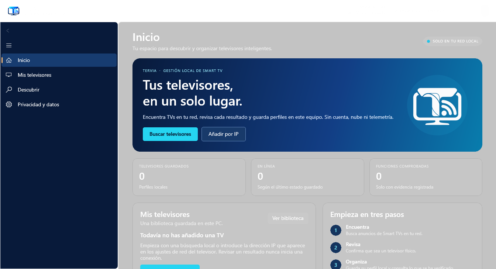
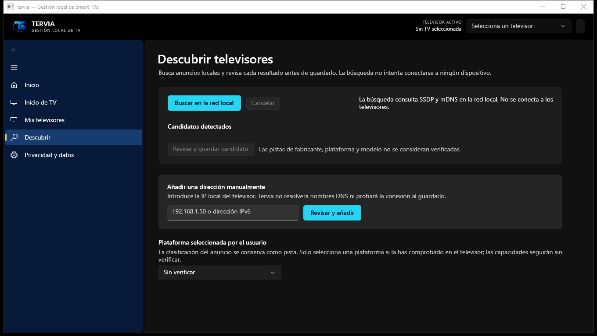
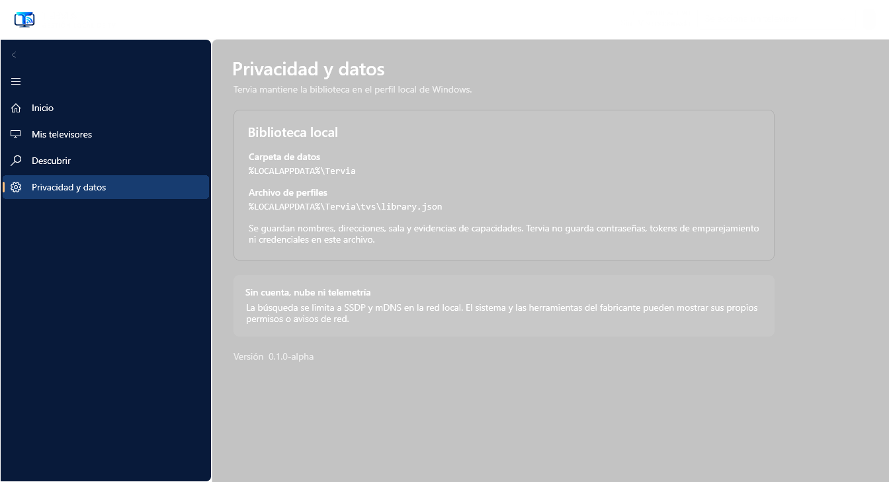

# Tervia

<p align="center">
  <picture>
    <source media="(prefers-color-scheme: dark)" srcset="assets/branding/logo-tervia-white.png">
    
  </picture>
</p>

<p align="center"><strong>Diseña el inicio de tu Android TV desde Windows.</strong><br>
Personaliza Tervia Home, elige qué aplicaciones aparecen y selecciona el inicio con el consentimiento del propio televisor.</p>

<p align="center">
  <a href="https://github.com/smouj/tervia/actions/workflows/ci.yml"></a>
  <a href="https://github.com/smouj/tervia/actions/workflows/codeql.yml"></a>
  <a href="LICENSE"></a>
  
  
  
</p>

---

Tervia combina una aplicación de escritorio para Windows con **Tervia Home**, un launcher
para televisores Android TV, Google TV y algunos Fire TV que permiten ADB por red. Desde
Windows eliges el título, subtítulo, color, reloj y aplicaciones visibles o fijadas; en
la TV, Android muestra su propia confirmación para establecer la pantalla de inicio.
El inicio del fabricante permanece instalado y se puede volver a elegir en Ajustes.
Tervia también descubre y organiza televisores físicos de otros sistemas, mostrando con
claridad qué funciones están implementadas y cuáles siguen pendientes.

> **Estado: alpha.** Tervia Home ya tiene APK propio, vista previa en Windows y controles
> para personalizar aplicaciones, apariencia y textos. La instalación y el cambio de
> launcher requieren que la TV permita ADB por red, que el usuario autorice este PC y
> que confirme Tervia Home en Android. La app no desactiva ni elimina el launcher original.
> El flujo está compilado y probado automáticamente; aún no se ha validado en modelos de
> TV físicos, así que la compatibilidad depende del fabricante y firmware.

## Así se ve la aplicación

Estas imágenes se capturan de la aplicación Tervia ejecutándose en Windows. Son
pantallas de la aplicación de escritorio; **no son capturas de una televisión**.
La captura real por ADB está disponible bajo demanda para TVs Android compatibles,
pero todavía no hay modelos validados en hardware.

| Escritorio: resumen | Escritorio: descubrimiento |
| --- | --- |
|  |  |

| Escritorio: privacidad |
| --- |
|  |

La vista previa del inicio que se personaliza desde Windows aparece en la sección
**Inicio de TV**. La imagen de escritorio es una vista previa orientativa; la TV carga
sus propios iconos y aplicaciones.

## Descargar y empezar

**Windows 10 (versión 1809 o posterior) o Windows 11, x64.** La publicación de
Windows se distribuye como un ZIP portátil autocontenido: no requiere instalar por
separado .NET ni Windows App SDK. La descarga no instala servicios ni cambia el
launcher de la TV por sí sola.

1. Descarga `Tervia-win-x64.zip` desde [Releases](https://github.com/smouj/tervia/releases).
2. En el Explorador, pulsa **Extraer todo**.
3. Abre `Tervia.exe` desde la carpeta extraída.

Si Windows indica que falta el runtime de Visual C++, instala el
[paquete x64 oficial de Microsoft](https://aka.ms/vc14/vc_redist.x64.exe) y vuelve a
abrir Tervia.

El ZIP de **Releases** incluye .NET y Windows App SDK. La versión pública actual,
`v0.1.0-alpha`, es anterior a Tervia Home y **no incluye su APK**. El siguiente paquete
Android necesita una clave de firma estable configurada en GitHub Actions para que las
futuras actualizaciones puedan instalarse sobre la misma app. Para compilar y probar
Tervia Home antes de esa publicación, sigue [Desarrollo](docs/DEVELOPMENT.md).

Si Windows te pide descargar .NET, confirma que extrajiste el ZIP completo y abriste
`Tervia.exe` (no `Tervia.dll` ni una versión compilada desde el código). Para compilar
Tervia desde el repositorio sí se necesita el SDK de .NET 10, Java 17, Gradle Wrapper y
Android SDK.

La aplicación no está firmada con un certificado comercial; Windows SmartScreen puede
mostrar un aviso. Comprueba el SHA-256 publicado junto al ZIP y continúa solo si
confías en la descarga. En PowerShell puedes calcularlo con
`Get-FileHash .\Tervia-win-x64.zip -Algorithm SHA256` y compararlo con
`SHA256SUMS.txt`. No hace falta una cuenta de Tervia para usar las funciones locales.
Consulta [Seguridad](SECURITY.md) para informar de problemas.

## Qué puedes hacer ahora

- **Diseñar Tervia Home:** cambiar título, subtítulo, tema de color y reloj; ocultar apps
  de la cuadrícula o fijar algunas primero. Cada perfil queda guardado por televisor en
  este PC. Al abrir el editor, Tervia consulta por ADB el inventario de apps de la TV
  seleccionada; solo sincroniza el diseño cuando eliges la acción.
- **Instalar en la TV:** el APK se distribuye junto al ejecutable. La instalación se
  dirige a Android TV, Google TV y televisores Fire TV compatibles. Antes debes activar
  ADB/developer mode en la TV y aceptar el aviso de autorización de este PC. Para
  seleccionar Tervia Home, confirma el diálogo del sistema Android en la televisión.
  Android puede mostrar una pantalla de selección de inicio en lugar del diálogo de rol.
  La pantalla del fabricante sigue disponible desde **Elegir launcher en la TV**.
- **Inicio:** consultar el resumen de tu biblioteca y llegar a las acciones principales.
- **Descubrir:** buscar anuncios SSDP y servicios mDNS en la red local.
- **Añadir manualmente:** introducir una dirección IPv4 o IPv6 local sin probar la
  conexión ni resolver nombres DNS.
- **Revisar y guardar:** confirmar que el resultado corresponde a un televisor físico
  antes de guardarlo en la biblioteca de este PC.
- **Capturar pantalla:** desde el perfil de un Android TV, Google TV o Fire TV, conectar
  por ADB solo al pulsar **Conectar y capturar** y mostrar el PNG en esa ventana. Puede
  aparecer una solicitud de autorización en la pantalla de la TV. La imagen no se guarda
  en el perfil; HDMI, Live TV y vídeo protegido pueden impedir la captura.
- **Control remoto básico:** enviar Arriba, Abajo, Izquierda, Derecha, OK, Atrás, Inicio
  o Menú a un Android/Google/Fire TV desde su perfil. Cada tecla abre una conexión ADB
  explícita; el modelo y firmware pueden variar en su respuesta.
- **Privacidad:** consultar qué datos guarda Tervia y qué actividad de red realiza.

Guardar una dirección **no** empareja, sondea ni controla el dispositivo. Una pista de
fabricante o protocolo no demuestra que un dispositivo sea una TV ni que una función
esté disponible.

## Compatibilidad, sin promesas implícitas

Tervia está construida por capacidades, no por una lista fija de marcas. Los anuncios
locales pueden sugerir Roku, Tizen, webOS, VIDAA, Fire TV o Android/Google TV, pero la
detección solo produce candidatos y pistas. No hay modelos de televisores verificados
en hardware real todavía.

| Función | Estado actual |
| --- | --- |
| Interfaz de escritorio WinUI 3 | Disponible en esta alpha |
| Descubrimiento local SSDP y mDNS | Implementado; resultado no equivale a compatibilidad verificada |
| Alta manual y biblioteca local | Disponible; guardar no inicia una conexión |
| Captura de pantalla bajo demanda por ADB | Implementada para Android/Google/Fire TV; pendiente de validación física por modelo |
| Teclas básicas del control remoto por ADB | Implementadas para Android/Google/Fire TV; pendientes de validación física por modelo |
| Tervia Home: instalar, aplicar textos/tema/reloj y gestionar visibilidad/orden de apps | Implementado; pendiente de validación física por modelo |
| Gestión de apps y diagnósticos generales desde la interfaz | Pendiente |
| Emparejamiento Tizen/webOS y pruebas físicas por modelo | Pendiente |
| Captura de pantalla en Roku, Tizen, webOS y VIDAA | No disponible en esta alpha |

Consulta [COMPATIBILITY.md](docs/COMPATIBILITY.md) para los estados por plataforma y
los resultados de pruebas en hardware. Los estados actuales son `Unknown`, `Supported`,
`Restricted` y `Unavailable`; `Restricted` indica que se necesita configuración o
pairing. Un candidato detectado no se marca `Supported` por el mero hecho de reconocer
su marca o plataforma.

## Privacidad y seguridad

- Sin cuenta, suscripción, anuncios ni telemetría de Tervia.
- Perfiles y datos locales en `%LOCALAPPDATA%\Tervia`.
- La búsqueda consulta la red local mediante SSDP y mDNS. Añadir una IP manualmente no
  contacta ese dispositivo.
- La captura y Tervia Home requieren `adb.exe` de
  [Android SDK Platform-Tools](https://developer.android.com/tools/releases/platform-tools).
  Tervia lo busca en `ANDROID_SDK_ROOT`, `ANDROID_HOME` y la ruta habitual del SDK local;
  si lo instalaste en otra ubicación, añade `platform-tools` a `PATH`. Además, la
  depuración ADB por red debe estar habilitada en la TV. Actualmente usa el puerto
  clásico 5555; no implementa el emparejamiento Wireless debugging por código o QR.
  Tervia no almacena claves de ADB; desactiva la depuración en los ajustes del televisor
  al terminar. Consulta la [guía oficial de ADB](https://developer.android.com/tools/adb).
- Cada tecla del control remoto abre y cierra una sesión ADB al pulsarla; no hay escucha
  en segundo plano ni control automático.
- Instalar o sincronizar Tervia Home abre una sesión ADB únicamente tras pulsar el botón
  correspondiente. Android pide autorización del PC si aún no existe. Tervia solicita el
  rol `HOME` mediante el diálogo del sistema; nunca ejecuta `pm disable`, `pm uninstall`
  ni modifica la selección del launcher original sin que el usuario lo confirme en la TV.
- Las capturas se muestran en memoria y se descartan al cambiar de televisor o cerrar la
  ventana. Si el modo directo no produce un PNG válido, se usan archivos temporales
  únicos en el PC y la TV; Tervia intenta borrarlos al terminar.
- Las pistas de red no se tratan como identidad verificada.
- Las operaciones sensibles deben pasar por el motor de seguridad y requerir
  confirmación cuando corresponda.

Lee [PRIVACY.md](docs/PRIVACY.md) y [SECURITY_MODEL.md](docs/SECURITY_MODEL.md).

## Compilar desde el código fuente

Se necesita .NET 10 SDK. Para compilar la interfaz, utiliza Windows:

```powershell
dotnet restore Tervia.sln -p:Platform=x64
dotnet build Tervia.sln -c Release -p:Platform=x64 --no-restore
dotnet test Tervia.sln -c Release -p:Platform=x64 --no-build --no-restore
```

En Linux o macOS, compila las bibliotecas portables y los tests con:

```bash
dotnet restore Tervia.Portable.slnf
dotnet build Tervia.Portable.slnf -c Release --no-restore
dotnet test Tervia.Portable.slnf -c Release --no-build --no-restore
```

El flujo de CI compila también el shell WinUI en Windows. Más detalles en
[Desarrollo](docs/DEVELOPMENT.md).

## Documentación

| Documento | Contenido |
| --- | --- |
| [Arquitectura](docs/ARCHITECTURE.md) | Capas, dependencias y adaptadores |
| [Capacidades](docs/CAPABILITIES.md) | Identificadores y estados de funciones |
| [Compatibilidad](docs/COMPATIBILITY.md) | Estado por plataforma y hardware probado |
| [Descubrimiento](docs/DISCOVERY.md) | SSDP, mDNS y alta manual |
| [Modelo de seguridad](docs/SECURITY_MODEL.md) | Confirmaciones, procesos y secretos |
| [Privacidad](docs/PRIVACY.md) | Datos locales y actividad de red |
| [Recuperación](docs/RECOVERY.md) | Snapshots y límites de restauración |
| [Modo sin conexión](docs/OFFLINE_MODEL.md) | Funciones que no necesitan Internet |
| [Fuentes de plataforma](docs/REFERENCES.md) | Documentación oficial de Android y de ecosistemas Smart TV |
| [Desarrollo](docs/DEVELOPMENT.md) | Build, CI y milestones |
| [Cambios](CHANGELOG.md) | Historial de versiones |

## Contribuir

Lee [CONTRIBUTING.md](CONTRIBUTING.md) y el [Código de conducta](CODE_OF_CONDUCT.md).
No se declara una capacidad compatible hasta aportar pruebas y actualizar la matriz de
compatibilidad. Los informes de seguridad se reciben en privado según
[SECURITY.md](SECURITY.md).

## Licencia

MIT. Consulta [LICENSE](LICENSE).
